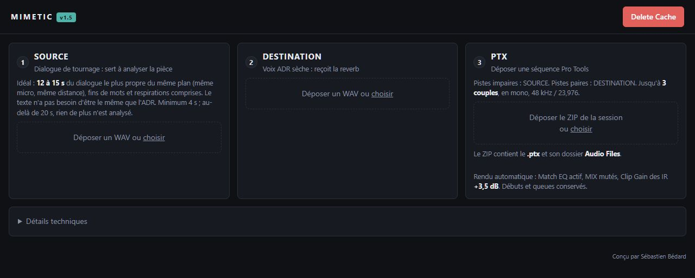
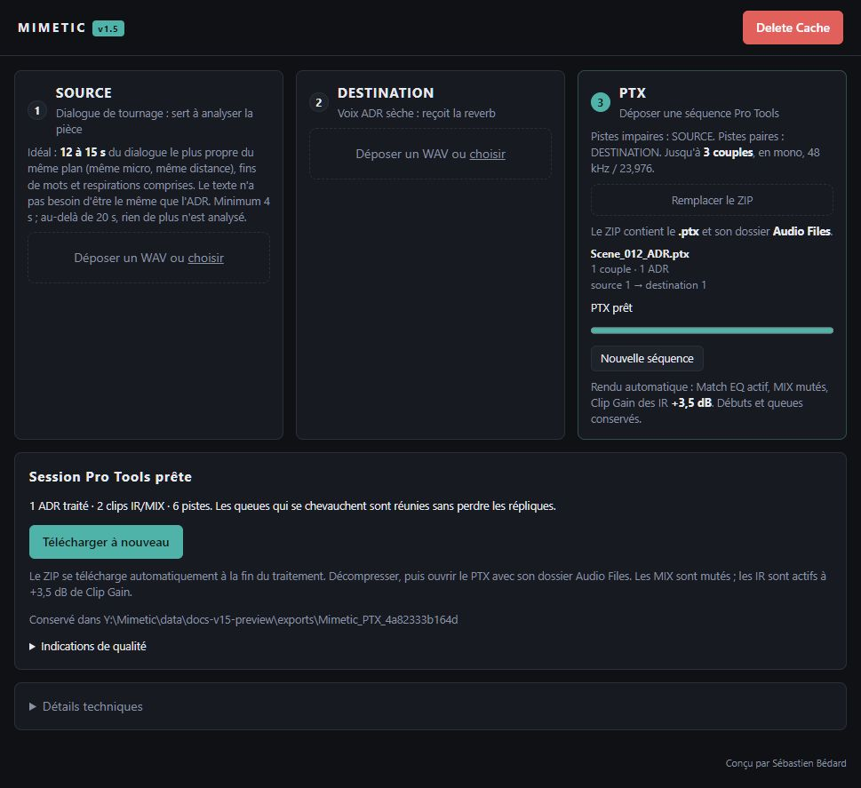

# Mimetic

**Give your ADR the room it was shot in.** Mimetic analyses a production recording
and applies its room acoustics and tonal character to dry ADR.

Processing runs locally on CPU, with no cloud upload or GPU required. The web
interface can be opened from other computers on your trusted LAN.



[](LICENSE)


## Features

- **Room matching:** estimate the location's reverb from production dialogue.
- **Match EQ:** match the ADR's tone, with adjustable strength.
- **Separate exports:** 100 % wet reverb, voice + reverb mix, or an impulse response
  to load into a convolution reverb.
- **Two-channel support:** analyse and process boom/lavalier channels independently.
- **Preview and adjust:** audition the results and change reverb level, pre-delay
  and EQ strength before exporting.
- **Pro Tools sessions:** process reference/ADR track pairs from a session ZIP
  and return IR/MIX clips at their original timecodes.
- **Automatic downloads:** finished WAVs and session ZIPs download immediately;
  reports include any analysis warnings.

## Audio workflow

1. Drop the production recording into **SOURCE**.
2. Drop the dry ADR into **DESTINATION**.
3. Preview the automatic result, adjust the settings and export.

Supports mono and two-channel WAV files at 44.1 or 48 kHz.
Use a representative production take and the driest available ADR.

## Pro Tools workflow

Drop a ZIP containing a `.ptx` session and its **Audio Files** folder into **PTX**.
Odd-numbered tracks are references; even-numbered tracks are ADR.

Supports up to three mono pairs in **48 kHz / 23.976** sessions. Consolidate clips
and fades first; paired clips must start together. Short ADR lines are retained.

The result includes the PTX, rendered audio and a report. **IR clips are active
with +3.5 dB Clip Gain; MIX clips are muted.**



## Quick start — Windows

Requires **Windows 10/11, Python 3.11 and Git**.

```bat
setup.cmd
run.cmd
```

Open the address printed in the console. Setup installs the dependencies and
downloads the model; subsequent processing runs locally.

Room acoustics are estimated, so results depend on the reference recording.
Mimetic does not generate background ambience. Technical documentation and
validation are available in [docs](docs/).

## Credits and license

Created by Sébastien Bédard. Room estimation uses
[Rec-RIR](https://github.com/Audio-WestlakeU/Rec-RIR); Pro Tools support uses
[pt_api](https://github.com/sebedard-creator/pt_api).

Mimetic is [MIT licensed](LICENSE). Third-party components retain their own
licenses. The interface and most documentation are in French.

## Mac version

A standalone app is available for **Intel Macs running macOS Monterey
(tested on 12.7.6)**. Drop a Pro Tools session ZIP onto the app to create an
IR/MIX session ZIP in **Downloads**, with no Python installation required.

[Precompiled app](macos-portable/releases/Mimetic-Mac-Intel-Monterey.zip) ·
[Releases and installation notes](https://github.com/sebedard-creator/Mimetic/releases)
